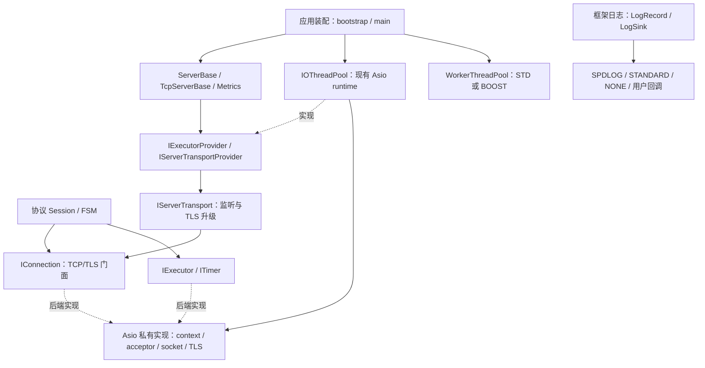

# 日志、Worker 与网络后端解耦（2026-10-20）

> 本页保留 2026-10-20 阶段记录。2026-10-22 的框架/邮件分层、客户端、数据库与构建模块状态见 [依赖边界与后续重构](dependency-boundaries.md)。

本次重构把服务端协议所需的调度、连接、监听和 TLS 操作收敛为框架接口，并保留 Asio 实现。现有邮件服务继续使用 Asio 后端，不需要等待原生传输实现才能运行。日志和业务 Worker 已可独立选择后端；**完整邮件服务目前仍需要 Asio，SQLite 驱动尚未实现**。

## 提交与行为变化

| 提交 | 变化 | 使用方式或影响 |
|---|---|---|
| `df0484f` | 独立日志接口、标准库 Worker | 日志可选 SPDLOG/STANDARD/NONE 或注入回调；Worker 默认 STD，保留 BOOST |
| `f04d564` | Session 调度与 POP3 定时任务迁移 | 协议层通过 executor/timer 工作，不需要获取 Asio context；移除 `make_copyable` 桥接 |
| `a5c6bdb` | 监听、TCP/TLS 和 STARTTLS 后端隔离 | TcpServerBase、连接门面及 Metrics HTTP 使用 transport provider；Asio 对象留在适配器内 |
| `1735246` | 协议启动握手与 POP3 写入修正 | POP3/HTTP/H2 在协议读写前完成握手；POP3 多行回复合并写入，避免重叠异步写 |

## 当前依赖方向



图中的 IOThreadPool 是当前生产实现。框架接口和独立契约测试可以使用其他实现；仓库尚未提供可部署的原生 socket runtime/transport。

应用装配方创建并启动共享 IO/Worker 池，服务器只使用注入资源，不负责停止共享池。当前 ServerBase 和配置仍保留邮件 router/cache 等类型；本次网络后端解耦没有完成框架与邮件应用的全部拆分。

## 日志与 Worker

日志公共接口位于 `include/framework/log/`：

- `LogLevel`、`LogRecord`、`LogSink` 不暴露 spdlog 类型。`Logger::set_handler()` 可接入任意记录函数，`set_sink()` 可接入自定义对象。
- `PROTORELAY_LOG_BACKEND=SPDLOG` 保留默认适配器；STANDARD 使用标准库控制台/滚动文件输出，NONE 关闭默认输出。STANDARD/NONE 不查找、包含或链接 spdlog/fmt。
- 显式注入的 sink/callback 优先于后续 bootstrap 初始化。回调可以并发执行，使用者负责自身同步；框架在注册表锁外调用用户函数，并隔离日志处理和 flush 异常。
- 格式化只支持项目已有的顺序 `{}` 及大括号转义，不承诺兼容完整 fmt 格式语法。

业务代码使用 `ThreadPoolBase`；装配时通过 `WorkerThreadPool` 别名选择 `StdThreadPool` 或保留的 `BoostThreadPool`：

- `PROTORELAY_WORKER_BACKEND=STD` 为默认值，使用标准线程、任务队列及同步原语。
- `stop(true)` 排空；`stop(false)` 丢弃排队任务并等待正在执行的任务退出。被丢弃任务的 future 得到 `broken_promise`。
- 生命周期操作从池外调用，停止后可以重新启动；任务异常不会逃出 Worker 线程。
- 标准 Worker 是计算/阻塞任务池，**不提供网络 IO runtime**。

日志用法见 [日志指南](../build-deploy/logging-guide.md)。

## 网络接口与所有权

| 接口或类型 | 职责 | 契约 |
|---|---|---|
| `IExecutor` / `IExecutorProvider` | 投递任务、创建定时器、选择执行器 | `post` 不内联；同一个 executor 上的任务和定时回调串行执行 |
| `ITimer` | 设置相对期限、等待、取消 | 在所属 executor 上修改；重设/取消完成被替换的等待，错误为 `operation_canceled` |
| `IConnection` | 读、写、握手、取消和关闭 | 完成回到连接 executor；每方向至多一个在途操作；成功写入整个缓冲区，读取可返回部分数据 |
| `TcpConnection` / `SslConnection` | 保留协议会话工厂使用的类型门面 | 持有并转发到 `unique_ptr<IConnection>`，不公开 Asio socket 或 SSL context |
| `IServerTransport` | 多监听器配置、接入回调、TLS 配置、STARTTLS 升级 | stop 返回后不再产生接入回调；不停止已注入 runtime 或已接入连接 |
| `IServerTransportProvider` | 为服务器创建监听服务 | 外部只传框架的监听/TLS 配置，后端自行管理 acceptor、context 和线程 |

缓冲区是非拥有视图，调用者必须保持缓冲区和连接存活到完成回调。Session 用 `shared_ptr` 维持异步生命周期，底层连接仍由 `unique_ptr` 独占；移除 `make_copyable` 不表示底层连接可以复制。采用 `std::function` 的任务仍须满足可复制要求。

STARTTLS 在明文回复写完、没有其他 IO 在途后执行，消耗明文连接并返回 TLS 连接；保留原连接的串行 executor、追踪信息和监听策略。TLS context 的寿命由适配器持有，不依赖服务器先于连接析构。

### Asio 实现内部的线程拓扑

`src/framework/net/asio_server_transport.cpp` 内部持有监听 context、work guard、各端口的 acceptor、TLS context 和监听线程。同一服务器的各个 acceptor 共用该监听 context；接入 socket 轮转绑定 IOThreadPool 的 context，后续连接读写和定时回调运行在连接的串行 executor 上。

协议层不再管理 context/work guard。IOThreadPool 本身仍是 Asio 实现，其他尚未迁移的客户端/数据库路径仍可以直接依赖它。

### 错误边界

网络回调继续使用 `std::error_code`，不引入一套覆盖标准库和所有驱动的异常继承树：

- EOF 映射到 `pr::net::IoErrc::end_of_stream`；取消映射到 `std::errc::operation_canceled`。
- 其他后端错误保留 category/value，便于诊断。
- 适配器内同步 `boost::system::system_error` 转为 `std::system_error`，原异常作为 nested cause 保留；用户异常不改写为 IO 错误。

## 已迁移与仍有依赖的路径

已迁移：Session 投递和超时、持久化完成等待、POP3 锁清扫/心跳、SMTP/IMAP 延迟关闭、TCP/TLS 连接门面、服务端监听/STARTTLS，以及 Metrics HTTP。

仍依赖 Asio：

- SMTP `ClientSession` 的公开 executor/TLS 配置、DNS/connect 和连接操作。
- OutboundServer 的 strand/timer，以及 submission 和 Webmail SMTP submitter 的 executor 注入。
- IOThreadPool 与 `current_io_context()` 注册机制；SMTP/IMAP FSM 头还残留 Boost SSL include。
- MariaDB 的 socket 就绪等待：IO 线程使用 Asio POSIX descriptor/timer，Worker 使用阻塞 `poll`。Connector/C 自己管理 socket 收发/关闭，应用负责等待事件后继续 `_cont()`。

MariaDB 当前还使用 `dlopen/dlsym`、`fcntl` 等 POSIX API；Windows 移植和无 Asio 的原生异步等待暂缓。同步 MySQL 驱动不使用这套 Asio 等待路径。`async_*` 的默认实现仍是同步调用加内联回调，不能仅凭方法名称认为底层非阻塞。

完整服务保留以上依赖即可继续使用当前后端。移除 Asio 也不等于移除所有 Boost：邮件持久化队列仍使用 `boost::lockfree::queue`。根 CMake 的公共源文件和依赖查找尚未完全按模块裁剪，运行时关闭数据库不会自动移除编译/链接依赖。

## 构建与验证

保留现有网络/数据库实现，选择标准日志和 Worker：

```bash
cmake -S . -B build/standard \
  -DPROTORELAY_LOG_BACKEND=STANDARD \
  -DPROTORELAY_WORKER_BACKEND=STD
cmake --build build/standard --target smtpsServer webmailServer unit_tests
ctest --test-dir build/standard --output-on-failure
```

兼容后端使用 `PROTORELAY_LOG_BACKEND=SPDLOG` 和 `PROTORELAY_WORKER_BACKEND=BOOST`。`build.sh` 接受同名环境变量；object-only 部署的 `link.sh` 要使用相同日志后端。

仅验证无 Asio 的框架契约：

```bash
cmake -S . -B build/core -DPROTORELAY_BUILD_BACKEND_CONTRACTS_ONLY=ON
cmake --build build/core
ctest --test-dir build/core --output-on-failure
```

这个配置编译真实 ServerBase、日志和标准 Worker，使用确定性测试后端验证连接、STARTTLS 交接与 Metrics HTTP。只要求 C++17、Threads、nlohmann_json，不查找 Boost、OpenSSL、spdlog/fmt、c-ares 或 MySQL；它不生成可部署的无 Asio 邮件服务。

2026-10-20 对现有构建产物复核：STANDARD/STD 为 42/42，SPDLOG/BOOST 为 42/42，独立契约为 5/5。两个完整配置应顺序运行：IMAP 用例共用固定 `/tmp/imaps_fetch_*` 路径，本次并行运行出现一次断言失败，单独完整复跑通过，与共用目录被另一进程清理的干扰相符；未因此修改产品代码。这些是本地回归结果，不替代线上数据库和邮件收发验收。

上一阶段已完成 TCP/TLS/STARTTLS 协议冒烟和 ASan/UBSan 选定用例验证。本次更新只修改文档，未重新部署服务。
