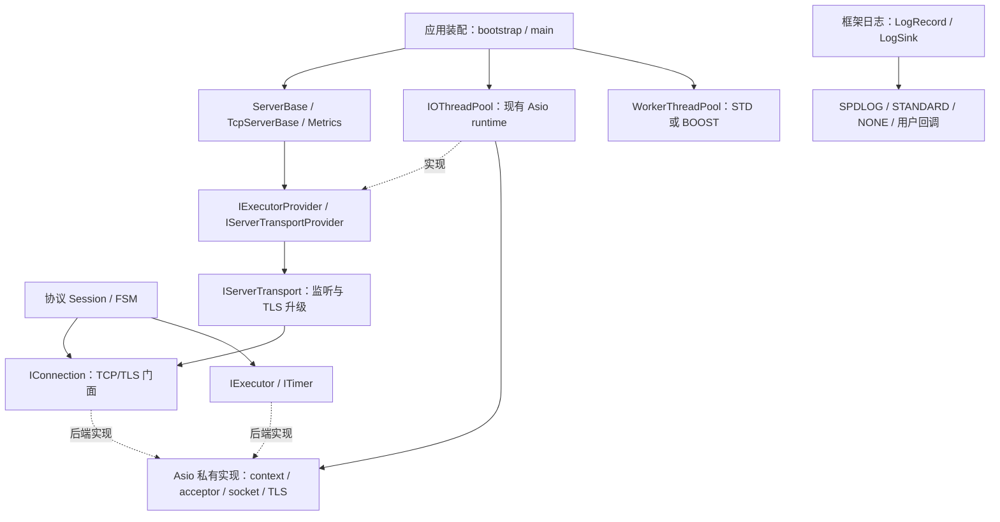

# 日志、Worker 与网络后端解耦（2026-10-20）

> 本页保留 2026-10-20 阶段记录。2026-10-22 的框架/邮件分层、客户端、数据库与构建模块状态见 [依赖边界与后续重构](dependency-boundaries.md)。
>
> **2026-11-13 更新**：下文"完整邮件服务目前仍需要 Asio，SQLite 驱动尚未实现"
> 与"仓库尚未提供可部署的原生 socket runtime"已过时。现状：
> - 原生（非 Asio）后端已可部署：配置 `io_backend: "native"` 在装配根选择
>   `NativeRuntime`（kqueue/epoll/poll 三后端，TLS 走可选的
>   `protorelay_native_tls`，缺失时全部 TLS 入口 fail-closed）。
> - 数据库约束：native 后端仅支持 SQLite 或 `use_database=false`
>   （MySQL/MariaDB 的 Asio 异步等待路径未迁移），bootstrap 会显式拒绝。
> - 验收：native 传输/运行时/TLS/框架组合单测 + POP3/IMAP/dual-server
>   e2e（`--backend native`）全绿；无 DB 中继走直投（见 SmtpsSession
>   的 transfer_mail_ownership_to_outbound），不入 outbox。
> - 默认仍是 `io_backend: "asio"`；Windows 支持整体暂缓（POSIX 头文件
>   未隔离是有意为之）。
>
> **2026-11-18 更新**：native TCP/SSL listener 的 accept loop 与连接 owner loop
> 分离；接入连接与 runtime 客户端/任务共用 RR cursor。线程归属、fd 交接与
> 外部/loop 内 `stop()` 的不同语义见下文 [Native 接入与连接 owner](#native-接入与连接-owner2026-11-18)。
> 本项不修改历史 benchmark，也不据此声明性能收益。

本次重构把服务端协议所需的调度、连接、监听和 TLS 操作收敛为框架接口，并保留 Asio 实现。现有邮件服务继续使用 Asio 后端，不需要等待原生传输实现才能运行。日志和业务 Worker 已可独立选择后端；**完整邮件服务目前仍需要 Asio，SQLite 驱动尚未实现**。

## 提交与行为变化

| 提交 | 变化 | 使用方式或影响 |
|---|---|---|
| `df0484f` | 独立日志接口、标准库 Worker | 日志可选 SPDLOG/STANDARD/NONE 或注入回调；Worker 默认 STD，保留 BOOST |
| `f04d564` | Session 调度与 POP3 定时任务迁移 | 协议层通过 executor/timer 工作，不需要获取 Asio context；移除 `make_copyable` 桥接 |
| `a5c6bdb` | 监听、TCP/TLS 和 STARTTLS 后端隔离 | TcpServerBase、连接门面及 Metrics HTTP 使用 transport provider；Asio 对象留在适配器内 |
| `1735246` | 协议启动握手与 POP3 写入修正 | POP3/HTTP/H2 在协议读写前完成握手；POP3 多行回复合并写入，避免重叠异步写 |

## 当前依赖方向



图中的 IOThreadPool 是当前生产实现。框架接口和独立契约测试可以使用其他实现；仓库尚未提供可部署的原生 socket runtime/transport。

应用装配方创建并启动共享 IO/Worker 池，服务器只使用注入资源，不负责停止共享池。当前 ServerBase 和配置仍保留邮件 router/cache 等类型；本次网络后端解耦没有完成框架与邮件应用的全部拆分。

## 日志与 Worker

日志公共接口位于 `include/framework/log/`：

- `LogLevel`、`LogRecord`、`LogSink` 不暴露 spdlog 类型。`Logger::set_handler()` 可接入任意记录函数，`set_sink()` 可接入自定义对象。
- `PROTORELAY_LOG_BACKEND=SPDLOG` 保留默认适配器；STANDARD 使用标准库控制台/滚动文件输出，NONE 关闭默认输出。STANDARD/NONE 不查找、包含或链接 spdlog/fmt。
- 显式注入的 sink/callback 优先于后续 bootstrap 初始化。回调可以并发执行，使用者负责自身同步；框架在注册表锁外调用用户函数，并隔离日志处理和 flush 异常。
- 格式化只支持项目已有的顺序 `{}` 及大括号转义，不承诺兼容完整 fmt 格式语法。

业务代码使用 `ThreadPoolBase`；装配时通过 `WorkerThreadPool` 别名选择 `StdThreadPool` 或保留的 `BoostThreadPool`：

- `PROTORELAY_WORKER_BACKEND=STD` 为默认值，使用标准线程、任务队列及同步原语。
- `stop(true)` 排空；`stop(false)` 丢弃排队任务并等待正在执行的任务退出。被丢弃任务的 future 得到 `broken_promise`。
- 生命周期操作从池外调用，停止后可以重新启动；任务异常不会逃出 Worker 线程。
- 标准 Worker 是计算/阻塞任务池，**不提供网络 IO runtime**。

日志用法见 [日志指南](../build-deploy/logging-guide.md)。

## 网络接口与所有权

| 接口或类型 | 职责 | 契约 |
|---|---|---|
| `IExecutor` / `IExecutorProvider` | 投递任务、创建定时器、选择执行器 | `post` 不内联；同一个 executor 上的任务和定时回调串行执行 |
| `ITimer` | 设置相对期限、等待、取消 | 在所属 executor 上修改；重设/取消完成被替换的等待，错误为 `operation_canceled` |
| `IConnection` | 读、写、握手、取消和关闭 | 完成回到连接 executor；每方向至多一个在途操作；成功写入整个缓冲区，读取可返回部分数据 |
| `TcpConnection` / `SslConnection` | 保留协议会话工厂使用的类型门面 | 持有并转发到 `unique_ptr<IConnection>`，不公开 Asio socket 或 SSL context |
| `IServerTransport` | 多监听器配置、接入回调、TLS 配置、STARTTLS 升级 | 外部 stop 返回后不再产生接入回调；native loop 线程内 stop 只请求停止，须由外部 stop 完成屏障；不停止已注入 runtime 或已接入连接 |
| `IServerTransportProvider` | 为服务器创建监听服务 | 外部只传框架的监听/TLS 配置，后端自行管理 acceptor、context 和线程 |

缓冲区是非拥有视图，调用者必须保持缓冲区和连接存活到完成回调。Session 用 `shared_ptr` 维持异步生命周期，底层连接仍由 `unique_ptr` 独占；移除 `make_copyable` 不表示底层连接可以复制。采用 `std::function` 的任务仍须满足可复制要求。

STARTTLS 在明文回复写完、没有其他 IO 在途后执行，消耗明文连接并返回 TLS 连接；保留原连接的串行 executor、追踪信息和监听策略。TLS context 的寿命由适配器持有，不依赖服务器先于连接析构。

### Asio 实现内部的线程拓扑

`src/framework/net/asio_server_transport.cpp` 内部持有监听 context、work guard、各端口的 acceptor、TLS context 和监听线程。同一服务器的各个 acceptor 共用该监听 context；接入 socket 轮转绑定 IOThreadPool 的 context，后续连接读写和定时回调运行在连接的串行 executor 上。

协议层不再管理 context/work guard。IOThreadPool 本身仍是 Asio 实现，其他尚未迁移的客户端/数据库路径仍可以直接依赖它。

### Native 接入与连接 owner（2026-11-18）

实现入口是 `src/framework/net/native_server_transport.cpp`、
`src/framework/net/native_runtime.cpp` 与 `include/framework/net/native_runtime.h`。
本节描述 native TCP/SSL transport，不改变上文保留的 Asio 拓扑及历史阶段记录。

#### Accept 与连接执行分离

- 每个 listener fd 仍只在一个 accept loop 上注册、监听和执行非阻塞 `accept()`；
  多 listener 的 accept loop 按 listener 槽位分配。
- 每次接受成功后，为**这条连接**选择 owner loop，将尚未注册到 poller 的 fd
  投递给 owner。`IConnection`、底层 stream/poller 注册、SSL 包装和 `AcceptHandler`
  都在目标 loop 上建立/执行；不是只把 handler 搬到另一个线程。
- 之后的握手、读写与完成回调沿连接的同一个串行 executor 执行。单个 listener
  因而可以把不同连接分配到多个 owner loop，而不是让所有连接跟随其 accept loop。
- `NativeRuntime` 用共享的 `shared_ptr<atomic<size_t>>` cursor 分配
  `next_executor()`、runtime 任务、client transport 和 server 接入连接；server transport
  持有同一 cursor，不保留 runtime 裸指针。`ConnectionAssignment` 持有候选 loop 的
  弱引用，transport 自身保持候选 loop 的寿命。
- RR 是按**该 runtime 中所有上述分配的合并顺序**轮转，不是每个 listener 的独立
  子序列。客户端或其他任务插入分配会改变下一条接入连接的 owner；线程归属测试
  使用独立 client runtime，避免以同一 runtime 的客户端分配扰动服务端序列。

SSL listener 在目标 owner loop 上把 plain stream 包成 TLS connection，TLS 的 owner
取自 `stream->loop`，不能取 listener 的 accept loop。STARTTLS 则消耗已有明文连接，
保留其原 executor，**不会重新选 owner 或迁移连接**；明文回复必须已写完且没有其他
IO 在途。取出 stream 后，先保存 loop，再移动 stream，避免在同一参数列表中混用
`stream->loop` 与 `std::move(stream)` 带来的求值顺序问题。

#### Pending fd 与 active lease

接入交付经过以下所有权阶段：

1. accept loop 把新 fd 放入 `PendingSocket`；它以原子 exchange 使 `take()` 与
   `close()` 至多有一方取得有效 fd。`DeliveryState` 在锁内登记 pending socket。
2. target task 通过 `claim()` 在同一 gate 锁内检查 stopped、移除 pending、取得 fd，
   复制 handler，并增加 active 计数。该段交付由 `DeliveryLease` 覆盖。
3. owner loop 创建连接成功后，fd 所有权交给连接，lease 不再负责关闭它；构造失败时
   由 lease 回收仍持有的 fd。TLS 包装失败则回收已消费的 stream。
4. handler 返回或抛异常后，lease 归还 active 计数并唤醒外部停止等待者。

handler 的调用与释放其用户捕获均在 gate 锁外进行，不能持 gate 执行用户回调。
排队 target task 只捕获目标 loop 的弱引用，不捕获 `ListenerState`，避免任务队列
通过这些内部对象强引用回自己的 target loop。stop 可直接取消仍 pending 的原始 fd，
不必等待忙碌 target loop 先处理交付；已经 claim 的 fd 不再由 pending 取消路径关闭。

#### `stop()` 的两种调用边界

- **所有调用**先标记停止接入、关闭 delivery gate 并回收 pending fd，然后安排各
  listener 的关闭。停止不等于关闭已经交给应用的连接，也不停止共享 runtime。
- **非 NativeLoop 线程调用**：同步完成 listener 关闭后，等待 active lease 归零。
  返回时没有正在执行或将开始的接入回调。外部重复调用仍是这一屏障，即使之前已由
  loop 内调用发出停止请求；并发外部调用也必须满足同一语义。
- **任意 NativeLoop 线程调用**：仅发出停止请求并安排 listener 清理，不同步等待
  其他 loop 或 active lease。这里也包括另一 `NativeRuntime` 的 loop，不只本
  transport 的 owner loops；由 `NativeLoop::is_any_loop_thread()` 的线程局部执行
  深度判断，`run()` 与测试驱动 `poll_once()` 的进入/退出都计入该深度。
  这避免 handler 内停止自身、以及两个 runtime 的回调交叉停止时互相等待。
- loop 内 `stop()` 返回**不是接入屏障**：已经 claim 的交付仍可能完成回调；需要
  确认接入完全静止的调用方，须在非 NativeLoop 线程再次调用 `stop()`。
- listener 的 `close_mutex` 仅串行化 `close_listener()` 的 registered/poller/fd
  清理，不包围 handler、跨 loop 调用或 active 等待。即使 loop 已退出、多个外部
  stop 都直接执行清理，也不能重复关闭同一 fd。
- deferred disposer 及其用户捕获的析构在 `graves_mutex` **外**执行，避免自身重入或
  两个 loop 的 disposer 互相请求 stop 时锁循环；退出线程时，对 grave 队列最后一次
  空检查与 `thread_active=false` 在同一锁内交接，保证并发 `defer_destroy()` 要么被
  loop 收尾处理，要么在解锁后 inline 处理，不遗留清理任务。`invoke_when_live()`
  的外部同步 teardown 也经同一 `graves_mutex` gate 入 grave 队列，以 promise 通知
  完成；同 loop 调用仍 inline。同步关闭不依赖普通任务队列，因此 `stop(false)`
  或普通 tasks 已排空后的晚到 teardown，也由上述退出交接覆盖。

#### 范围与验证边界

本次不引入 `SO_REUSEPORT`，不为同一 listener 建立每 worker 一个监听 socket，
也不让多个 loop 共享一个 poller；每个 loop 仍拥有自己的 poller。调整的是 accept 后
的连接分配，不是多 acceptor 或共享事件循环设计。

对应契约回归位于 `test/unit/native_transport_test.cpp` 与
`test/unit/native_tls_test.cpp`，涵盖多连接 owner 分散、回调线程归属、SSL owner、
STARTTLS executor 保持，以及停止交错。新增 TLS 场景按 `available_backends()`
遍历，使用 promise/超时推进，不用 sleep 猜测分配顺序。此处仅记录设计与回归范围，
不宣称本次构建、测试或性能测量已完成；验证结果由统一验证另行给出。
**旧 benchmark 数据与报告不修改，也不据本项改动声称吞吐、延迟或扩展性收益。**

### 错误边界

网络回调继续使用 `std::error_code`，不引入一套覆盖标准库和所有驱动的异常继承树：

- EOF 映射到 `pr::net::IoErrc::end_of_stream`；取消映射到 `std::errc::operation_canceled`。
- 其他后端错误保留 category/value，便于诊断。
- 适配器内同步 `boost::system::system_error` 转为 `std::system_error`，原异常作为 nested cause 保留；用户异常不改写为 IO 错误。

## 已迁移与仍有依赖的路径

已迁移：Session 投递和超时、持久化完成等待、POP3 锁清扫/心跳、SMTP/IMAP 延迟关闭、TCP/TLS 连接门面、服务端监听/STARTTLS，以及 Metrics HTTP。

仍依赖 Asio：

- SMTP `ClientSession` 的公开 executor/TLS 配置、DNS/connect 和连接操作。
- OutboundServer 的 strand/timer，以及 submission 和 Webmail SMTP submitter 的 executor 注入。
- IOThreadPool 与 `current_io_context()` 注册机制；SMTP/IMAP FSM 头还残留 Boost SSL include。
- MariaDB 的 socket 就绪等待：IO 线程使用 Asio POSIX descriptor/timer，Worker 使用阻塞 `poll`。Connector/C 自己管理 socket 收发/关闭，应用负责等待事件后继续 `_cont()`。

MariaDB 当前还使用 `dlopen/dlsym`、`fcntl` 等 POSIX API；Windows 移植和无 Asio 的原生异步等待暂缓。同步 MySQL 驱动不使用这套 Asio 等待路径。`async_*` 的默认实现仍是同步调用加内联回调，不能仅凭方法名称认为底层非阻塞。

完整服务保留以上依赖即可继续使用当前后端。移除 Asio 也不等于移除所有 Boost：邮件持久化队列仍使用 `boost::lockfree::queue`。根 CMake 的公共源文件和依赖查找尚未完全按模块裁剪，运行时关闭数据库不会自动移除编译/链接依赖。

## 构建与验证

保留现有网络/数据库实现，选择标准日志和 Worker：

```bash
cmake -S . -B build/standard \
  -DPROTORELAY_LOG_BACKEND=STANDARD \
  -DPROTORELAY_WORKER_BACKEND=STD
cmake --build build/standard --target smtpsServer webmailServer unit_tests
ctest --test-dir build/standard --output-on-failure
```

兼容后端使用 `PROTORELAY_LOG_BACKEND=SPDLOG` 和 `PROTORELAY_WORKER_BACKEND=BOOST`。`build.sh` 接受同名环境变量；object-only 部署的 `link.sh` 要使用相同日志后端。

仅验证无 Asio 的框架契约：

```bash
cmake -S . -B build/core -DPROTORELAY_BUILD_BACKEND_CONTRACTS_ONLY=ON
cmake --build build/core
ctest --test-dir build/core --output-on-failure
```

这个配置编译真实 ServerBase、日志和标准 Worker，使用确定性测试后端验证连接、STARTTLS 交接与 Metrics HTTP。只要求 C++17、Threads、nlohmann_json，不查找 Boost、OpenSSL、spdlog/fmt、c-ares 或 MySQL；它不生成可部署的无 Asio 邮件服务。

2026-10-20 对现有构建产物复核：STANDARD/STD 为 42/42，SPDLOG/BOOST 为 42/42，独立契约为 5/5。两个完整配置应顺序运行：IMAP 用例共用固定 `/tmp/imaps_fetch_*` 路径，本次并行运行出现一次断言失败，单独完整复跑通过，与共用目录被另一进程清理的干扰相符；未因此修改产品代码。这些是本地回归结果，不替代线上数据库和邮件收发验收。

上一阶段已完成 TCP/TLS/STARTTLS 协议冒烟和 ASan/UBSan 选定用例验证。本次更新只修改文档，未重新部署服务。
